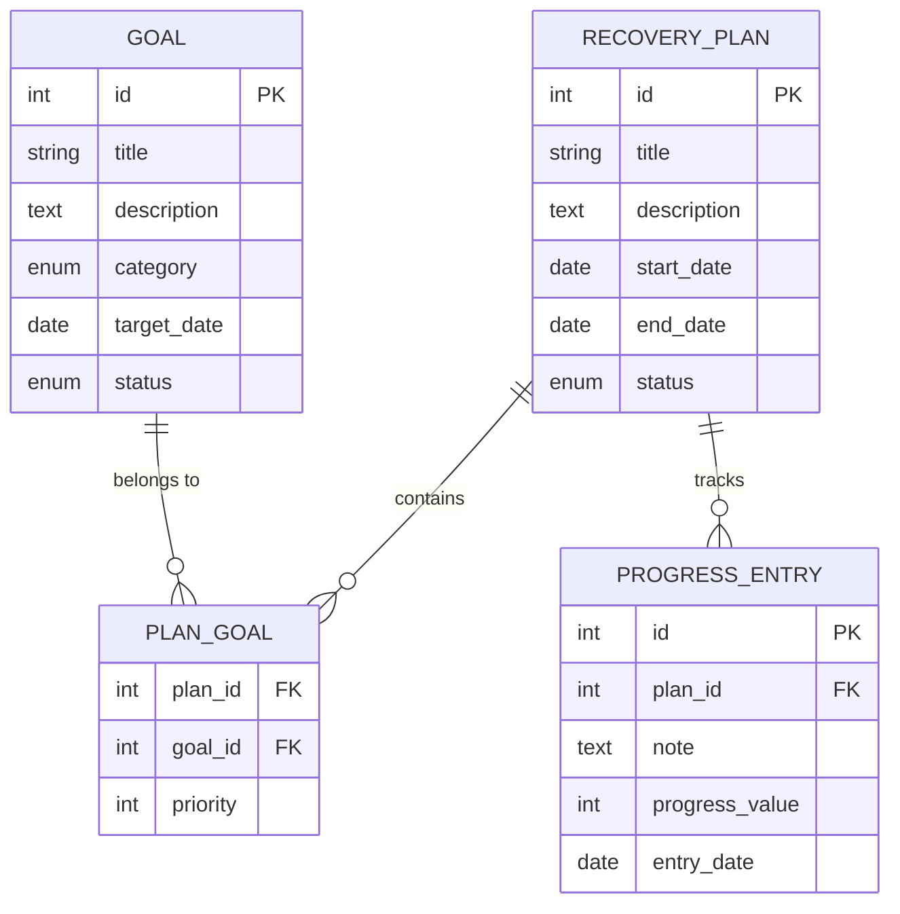

# Khotwa – Recovery Journey Platform

## Overview

This project was developed as part of the **Projet Technologies Web – 2nd Year Engineering Program (2A7)** at **Esprit School of Engineering** (Academic Year 2026–2027).

**Khotwa** (*"a step"* in Arabic) is a web platform that supports people through a personal recovery journey, one step at a time. This repository contains the **M3 – Recovery Journey** module: users build a personal recovery plan, define personal goals, link goals to plans, and follow their progress on a dashboard.

## Table of Contents

- [Overview](#overview)
- [Features](#features)
- [Tech Stack](#tech-stack)
- [Architecture](#architecture)
- [Contributors](#contributors)
- [Academic Context](#academic-context)
- [Getting Started](#getting-started)
- [Usage](#usage)
- [Contributing](#contributing)
- [License](#license)
- [Acknowledgments](#acknowledgments)

## Features

- Create, edit and delete **recovery plans** (title, dates, status: active / paused / completed)
- Create, edit and delete **personal goals** (category, target date, status: to do / in progress / done)
- Attach several goals to a plan (many-to-many through `PlanGoal`) with a priority order
- Progress dashboard with key figures (plans, active plans, goals, achieved goals)
- Server-side validation, CSRF protection and escaped output
- Common layout built from reusable partials (head, sidebar, header, footer, scripts) with automatic active menu link

## Tech Stack

### Frontend

- HTML5 / CSS3 (custom responsive stylesheet, light and dark mode)
- Vanilla JavaScript (preloader, responsive menu, delete confirmation)

### Backend

- PHP 8.1+ (MVC architecture, PDO)
- MySQL / MariaDB
- Apache (XAMPP / WAMP) or the PHP built-in server

## Architecture

The project follows the **MVC** pattern taught in the workshop: controllers receive requests, models talk to the database, and views are assembled through a single `layout.php`.

```text
khotwa/
├── index.php              # Front controller (router + autoloader)
├── config.php             # Database settings
├── database.sql           # Schema + sample data
└── app/
    ├── routes.php         # page key => [Controller, method]
    ├── helpers.php        # e(), url(), csrf, flash
    ├── Controllers/       # Controller, Dashboard, RecoveryPlan, Goal
    ├── Models/            # Model, RecoveryPlan, Goal, PlanGoal
    └── Views/
        ├── layout.php     # Assembles all partials
        ├── partials/      # head, sidebar, header, footer, scripts
        ├── pages/         # dashboard, plans, plan_form, goals, goal_form, 404
        └── assets/        # css, js
```

### Data model



## Contributors

| Name | Module |
|------|--------|
| [Mohamed Aziz Farhani](https://github.com/) | M3 – Recovery Journey (`RecoveryPlan`, `Goal`, `ProgressEntry`, `PlanGoal`) |
| *(team member)* | *(module)* |

## Academic Context

Developed at **Esprit School of Engineering – Tunisia**
Projet Technologies Web – 2A7 | 2026–2027

## Getting Started

1. Clone the repository:
   ```bash
   git clone https://github.com/<your-username>/Esprit-PW-2A7-2026-Khotwa.git
   cd Esprit-PW-2A7-2026-Khotwa
   ```
2. Create the database: import `database.sql` with phpMyAdmin (or `mysql -u root < database.sql`).
3. Adjust `config.php` if your MySQL credentials differ from the defaults (`root`, empty password).
4. Run the project, either:
   - **PHP built-in server**: `php -S localhost:8000`, then open <http://localhost:8000/index.php?page=dashboard>
   - **XAMPP / WAMP**: copy the folder into `htdocs` / `www`, start Apache and MySQL, then open `http://localhost/<folder>/index.php?page=dashboard`

## Usage

1. Open the **Dashboard** to see the number of plans, active plans, goals and achieved goals.
2. Go to **Objectifs personnels** and create your goals (category, target date, status).
3. Go to **Plans de rétablissement**, create a plan and tick the goals that belong to it.
4. Edit a plan or a goal at any time; deleting a plan removes its links to goals (`ON DELETE CASCADE`).

## Contributing

Contributions are welcome:

1. **Fork** the project from its GitHub page.
2. Clone your fork:
   ```bash
   git clone https://github.com/<your-username>/Esprit-PW-2A7-2026-Khotwa.git
   cd Esprit-PW-2A7-2026-Khotwa
   ```
3. Create a branch: `git checkout -b feature/my-feature`
4. Commit and push: `git commit -m "Add my feature"` then `git push origin feature/my-feature`
5. Open a **pull request**.

## License

This project is released under the **MIT License**. See the [LICENSE](./LICENSE) file for details.

## Acknowledgments

- **Esprit School of Engineering** for the academic framework and the Web Technologies Project workshops
- The teaching team for their guidance and feedback
